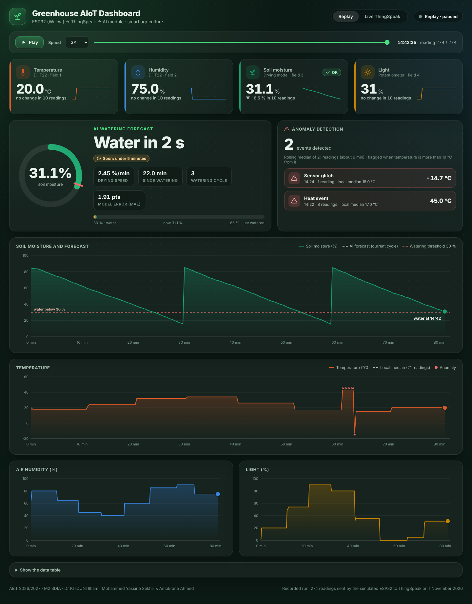

# Serre: greenhouse AIoT dashboard

Monitoring dashboard for our AIoT greenhouse prototype: a simulated ESP32 (Wokwi) sends temperature, humidity, soil moisture and light readings to ThingSpeak, and the dashboard adds an AI watering forecast and temperature anomaly detection.

**Course:** Artificial Intelligence of Things (AIoT), M2 SDIA, 2026/2027 · Supervisor: Dr KITOUNI Ilham
**Students:** Mohammed Yassine Sekhri, Amokrane Ahmed

## Features

- **Replay mode:** plays back our recorded run (274 readings sent to ThingSpeak on 1 November 2026), with the forecast and alerts updating as the day unfolds.
- **Live mode:** reads a ThingSpeak channel (channel ID, plus the Read API key for a private channel) and refreshes every 20 seconds.
- **AI watering forecast:** a linear regression on the current drying cycle predicts when soil moisture will fall below 30 %.
- **Anomaly detection:** each temperature reading is compared with the median of the 21 readings around it; more than 10 °C away is flagged.
- **Weather-aware forecast (extension, live mode):** with the weather-driven Wokwi sketch (version 2), a model trained on our synthetic seasonal dataset predicts the drying speed from temperature, humidity and light, shows how much each one speeds up or slows down drying, and compares the prediction with the measured drying speed.
- **Weather AI page:** explains the weather-aware model, lets you try it with sliders and season presets, and runs it hour by hour through the **real 7-day weather forecast** from the free [Open-Meteo](https://open-meteo.com/) API (Constantine, Algiers, Oran, Annaba or Biskra) to predict the day and hour of the next watering.
- Sensor cards with trends, interactive charts with tooltips, pop-up alerts and a data table.

The forecast and anomaly methods are the same as in our AI notebook (weeks 5–6).

## Run it

It is a single static file with no build step: open `index.html` in a browser, or deploy the folder to any static host (Vercel, GitHub Pages).

No API key is stored in the code. In live mode the Read API key stays in the browser and is sent only to ThingSpeak.
